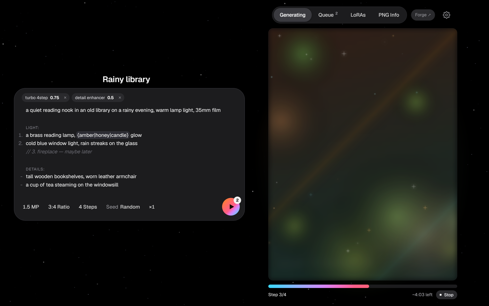

# Kiln

[English](README.md) · **Русский**

**Спокойный интерфейс с очередью для [Forge Neo](https://github.com/Haoming02/sd-webui-forge-classic/tree/neo), построенный вокруг Krea 2.**

Набросали очередь, закрыли дверь, вернулись к готовым картинкам. Kiln — приложение в одном окне для тех, кому нужно
качество Krea 2 без стены настроек Gradio и без графа нод. Идёт ли одна картинка минуты на скромной видеокарте или
длинная очередь на быстрой — пока он работает, есть на что посмотреть; а каждая готовая картинка возвращается
вместе со своим промптом и настройками, так что просматривать результаты — значит читать, что их сделало, а не
искать по файлам.

> **Статус: ранний, рабочий.** Kiln управляет локальным Forge Neo через его API: настоящая очередь, живое превью,
> ваши LoRA и модели.

---

## Быстрый старт

Нужны **Windows**, **[Forge Neo](https://github.com/Haoming02/sd-webui-forge-classic/tree/neo)** с моделью Krea 2
и **Python 3.10 или новее** ([python.org](https://www.python.org/downloads/) — в установщике отметьте
*«Add python.exe to PATH»*). Сам Kiln ничего не устанавливает.

1. **Включите API у Forge.** В файле Forge `webui-user.bat` добавьте `--api` в `COMMANDLINE_ARGS`, например
   `set COMMANDLINE_ARGS=--api`. Запустите Forge один раз и убедитесь, что он работает сам по себе.
2. **Скачайте Kiln.** На этой странице: **Code → Download ZIP**, распакуйте куда угодно (или `git clone`).
3. **Дважды щёлкните `kiln.bat`.** Он запустит сервер Kiln и откроет Kiln в отдельном окне Edge.
   Если Edge нет — откроется в браузере по умолчанию.
4. **Напишите промпт и нажмите ▶** (или `Ctrl+Enter`). Пока картинка рендерится, можно писать следующий.

**Необязательно — один ярлык на всё.** Скопируйте `config.example.json` в `config.local.json` и укажите в
`"forge_start"` полный путь к `webui-user.bat` от Forge (в JSON обратные слэши пишутся дважды:
`"C:\\Forge\\webui-user.bat"`). Тогда Kiln сам запускает Forge (свёрнутым), если тот не запущен, и закрывает его,
когда вы закрываете Kiln — но только если Forge запустил именно Kiln и им больше никто не пользуется
(`"stop_forge_on_exit": false` оставляет его работать).

**Настройки по умолчанию.** Kiln стартует с настройками под Krea 2 Turbo: 4 шага, CFG 1, Euler / Simple,
shift 1.15. Меняются в ⚙ Настройках. Модель, VAE и текстовый энкодер по умолчанию — те, что уже загружены в Forge.

**Если что-то не так**

| Что видите | Что попробовать |
|---|---|
| «Forge not running» | Forge не запущен, нет `--api`, или он не на порту 7860 (задайте `"forge_url"` в `config.local.json`). |
| Окно Kiln открывается пустым | VPN или прокси перехватывает локальный трафик. Собственное окно Kiln его обходит; в другом браузере добавьте `127.0.0.1` в исключения. |
| `kiln.bat` не находит Python | Переустановите Python с отметкой *«Add python.exe to PATH»*. |
| Оценка времени неточная | Она учится на ваших запусках — после нескольких картинок одного размера выравнивается. |

---

## Возможности

**Сначала — очередь**
- ▶ / `Ctrl+Enter` добавляет в очередь; если ничего не идёт, генерация начинается сразу. Пишите дальше, пока она идёт.
- Перетаскивание меняет порядок, × удаляет, **Stop** отменяет текущую задачу (она остановится после текущего шага —
  Forge не умеет посреди шага — и Kiln так и пишет). **×N** ставит пачку — со случайными сидами или по порядку от заданного.
- **Pause after this** (вкладка Queue): текущая картинка доделывается, новые не начинаются, пока не продолжите.
- **Выделение** готовых картинок: кружок в строке, Ctrl-щелчок, Shift-щелчок — диапазон (дальше обычный щелчок
  добавляет или убирает), Ctrl+A, Esc. Заголовок Finished превращается в действия: **All “Fox”** (вся серия), Select
  all, **Remove from list**, **Delete** (Del) — в Корзину, с одним Undo на все.
- Рассчитан на длинные очереди: сотни готовых картинок открываются и листаются сразу — маленькие миниатюры делаются
  один раз и хранятся, рисуются только видимые строки, а во время рендера Kiln спрашивает у сервера только прогресс.
- В строках видно, когда задача добавлена, когда готова и сколько шла; у текущей — живое превью (не при включённой
  приватности); при наведении на готовую миниатюру — крупнее. Имя ожидающей задачи можно поменять в её просмотре.
- **Удаление** картинки (`Del` или корзина рядом с ней) — в Корзину Windows, с Undo. ✕ на готовой строке только убирает
  её из списка. Картинки, удалённые вне Kiln, помечены *file deleted* (**Remove missing**);
  на такой картинке вместо неё карточка с тем, что можно сделать: **Restore from Recycle Bin** (исходный файл),
  **Save back** (если Kiln ещё держит её с этой сессии), **Render again** (тот же сид и то же имя файла) или
  **Remove from list**.
- **Апскейл** встаёт в начало очереди: это секунды, он идёт сразу после текущей картинки.
- Щелчок по готовой задаче открывает её в Gallery (✕ возвращает в Queue). Щелчок по ожидающей или текущей задаче
  показывает её промпт, не трогая ваш черновик; дальше **Reuse prompt** или
  **Reuse all** (с настройками и LoRA; с её сидом — если включён 🔒 рядом, иначе получится вариация). Reuse у картинки
  с именем берёт и имя — следующая попадёт в ту же серию. На каждой картинке одни и те же кнопки на тех же местах.
- **Честная оценка времени** по вашей истории: медиана последних пяти запусков с тем же размером картинки и числом
  шагов, с обратным отсчётом во время рендера (на реальной истории ошибка вдвое меньше, чем у среднего по мегапикселям).
  Итог по очереди считается так же.

**Редактор промпта** (CodeMirror 6, с проверкой орфографии) — ✕ в правом верхнем углу очищает его одним щелчком (Undo или `Ctrl+Z`)

| Пишете | Выглядит как | Уходит в модель |
|---|---|---|
| `// заметка себе` | приглушённый комментарий · `Ctrl+/` включает и выключает | **убирается** |
| `{cream\|charcoal\|green} sweater` | пилюля варианта | **один вариант на задачу** — пачки получаются разными сами |
| пункты `1.` / `-` | маркеры висят на полях, перенесённые строки выровнены | как написано |
| `Outfit:` отдельной строкой | маленький заголовок раздела | как написано |
| `<lora:name:0.6>` | чип LoRA | как написано (его разбирает Forge) |

В очереди видно, какой вариант достался каждой задаче, так что удачный результат можно отследить.

**Раскладка**
- Промпт и картинка — одна пара с зазором 18 px по центру окна. Во вкладке Generating область картинки облегает саму
  картинку (вертикальную или горизонтальную), так что промпт всегда рядом с ней; у Queue, LoRAs и PNG Info своя ширина.
  Картинка той же формы стоит точно на месте при переходе между Generating и Gallery.
- **Края:** разделитель между ними перераспределяет ширину (промпт не уже минимума); внешний край идёт за курсором,
  потом пара плавно встаёт по центру. Собственные края картинки задают её предел. При наведении на край картинку
  обводит пунктир; ручка — вся полоса между картинкой и пунктиром. Двойной щелчок по краю — значение по умолчанию.
- Шире окно — панели не растягиваются шире заданного, растут поля; уже окно — сначала уходят поля, потом сжимаются обе
  панели и возвращаются, когда место есть.
- **Меню раскладки** (значок рядом с шестерёнкой): промпт слева, справа или под картинкой и сброс размеров. Или
  перетащите промпт за строку имени в одну из стеклянных зон (при нажатии обводится весь блок, который поедет). При
  переключении всё плавно сменяется, а картинка переезжает на новое место.
  Узкое окно всё равно ставит их друг под друга.
- **Вертикально** (промпт снизу): картинка в колонке по центру (не шире 16:9 при её высоте), с равными отступами сверху
  и снизу; её размер задают верхний, нижний и боковые края. У блока промпта свои боковые края и кнопка **Fit width**
  (по ширине картинки). Блок занимает свой слот постоянной высоты — его задают линия над именем или нижний край (он идёт
  за указателем, а картинка уступает место, когда отпустите), — так что картинка не двигается от того, что написано в промпте.
- Рядом с картинкой: перетащите промпт за любое пустое место — он прилипнет к верху, середине или низу картинки; или
  включите **по высоте картинки** / **во всю высоту**.
- Ничего не уезжает из-под курсора: пока открыто меню в промпте, раскладка ждёт; стрелка на картинке, по которой вы
  щёлкаете, стоит на месте, пока на ней указатель. Все изменения раскладки идут по одной плавной кривой.

**Картинка**
- Живое превью под мягкой обложкой, которая сходит по мере шагов; россыпь искр, когда готово.
- **Что показывает область картинки** — по одним правилам: **Generating** — это живой вид: рендер, а когда задача
  готова — готовая картинка в полном качестве; она остаётся, пока у следующего рендера не появится своя картинка (✕
  убирает её; остановленный рендер возвращает картинку до него). Вкладка **Gallery** открывается на той картинке, на
  которую вы смотрите; вкладка **Generating** всегда возвращает к тому, что сейчас делается. Стрелки всегда меняют картинку.
- Щелчок по рендеру показывает его промпт в блоке (✕ / `Esc` возвращают черновик); пока вы правите другой, строка
  статуса пишет, что рендер — *another prompt*. Когда в блоке промпт задачи, ▶ — это **Vary** (ещё одна такая же,
  с новым сидом), а правка сразу делает его вашим черновиком (Ctrl+Z возвращает прежний). `→` на готовой картинке
  убирает её и показывает рендер.
- Картинка, которая закончилась, пока вы на другой вкладке или листаете Gallery, появляется маленькой карточкой под
  вкладкой Generating — щелчок открывает её.
- **Обложка** (Settings → Cover): полная, лёгкая или выключена, по желанию — без неё на задачах короче 10 с;
  навести на картинку — подглядеть.
- **Приватность** — глаз в правом верхнем углу картинки (есть и без картинки) или `F9` (даже при наборе текста): картинка закрыта целиком,
  идёт ли рендер или готово (без прозрачности, подглядывания при наведении и полноэкранного просмотра), а промпт, имя
  и LoRA скрыты. Остаётся включённой — между задачами и после перезапуска — пока не нажмёте снова.
- Действия с картинкой (img2img, апскейл, открыть, папка, превью LoRA, удалить) — в колонке рядом, видны при наведении
  на картинку или колонку.
- **Gallery** (вкладка слева от Generating): готовые картинки, которые листают `←` / `→` или стрелками на картинке —
  в том числе во время рендера. `←` из Generating ведёт в неё, `→` после самой новой — обратно. На каждой видно её имя
  и промпт (серым, с **Reuse prompt** / **Reuse all**). Картинки сменяются плавно; если меняется форма, рамка сначала
  сужается на уходящей картинке, потом раскрывается на следующей. **▶ в Gallery — это Vary** (кубик вместо треугольника):
  та же картинка с новым сидом — тот же промпт, настройки, LoRA и серия, — черновик не трогается. **Reuse** переводит
  в Generating и оставляет картинку образцом, пока вы правите промпт (идущий рендер её не вытесняет; о картинке,
  готовой за ней, скажет строка статуса), — до ▶ или ✕. После удаления открывается следующая картинка в ту сторону,
  куда вы листали.
- **Имена файлов:** наведите на заголовок готовой картинки — вокруг появится имя файла (`#27 Rome-003.png`). Измените
  заголовок и нажмите Enter — файл **переименуется**: попадёт в серию, которую вы написали, со следующим номером, имя
  внутри PNG обновится, Undo вернёт как было. Без имени серии файлы называются по дате и сиду.
- **Статус:** во время рендера под картинкой полоса с шагами, оставшимся временем и Stop; кольцо вокруг **G** во вкладке
  Generating (с вырезом вокруг букв) заполняется по ходу задачи на любой вкладке; ▶ переливается цветами полосы, а у
  числа очереди на ней своё кольцо. Пустая Generating пишет,
  что будет дальше и сколько займёт. Наведите на пилюлю МП — точный размер в пикселях.
- Сообщения Kiln появляются рядом с промптом и не закрывают кнопки; сообщения об очереди — под вкладкой Queue.
  Длинный промпт уходит под стеклянные кнопки и растворяется у краёв блока. **Уведомления** говорят только, что картинка
  готова, — без промпта и имени. При повторном открытии Kiln сообщает,
  сколько картинок закончилось, пока он был закрыт.
- `?` показывает все сочетания клавиш.
- Щелчок открывает **полноразмерный просмотр** (вписать ↔ 100%, колесо — масштаб, перетаскивание — сдвиг, стрелки —
  листание); двойной щелчок открывает файл в программе по умолчанию.

**Библиотека LoRA**
- Лица, Стили и Утилиты — компактными карточками (миниатюра, имя, переключатель, вес) в столько колонок, сколько
  помещается, по центру. Ползунок миниатюр меняет размер карточек. **Активные** LoRA — сверху, их вес можно править прямо там.
- Читаемые имена из типичных имён файлов (`krea2_<name>_v2_large_onetrainer` → *Name · v2 · large*),
  двойной щелчок — переименовать, избранное, недавние, поиск (✕ очищает его).
- **Одно лицо за раз** — LoRA меняют веса всей модели, поэтому две LoRA лиц сливаются в одно лицо; Kiln заменяет
  одну другой, а не складывает (отключается).

**Ещё**
- PNG Info: перетащите любой PNG из Forge, чтобы прочитать настройки и отправить их в промпт.
- Выбор пропорций с превью формы · пресеты ~1 / 1.5 / 2 МП (все стороны кратны 16).
- Заголовок окна и иконка вкладки показывают прогресс; уведомление, когда очередь опустела (вкл., без звука или выкл.).
- Закрытие окна Kiln останавливает сервер, как только очередь закончится.
- Собственный интерфейс Forge: Settings → Output → Open Forge.
- Четыре скина: Aurora (северное сияние), Embers, Matrix (кодовый дождь), Starscape — у каждого свои цвета, фон,
  обложка и финал; как выглядит каждый — небольшой файл в `app/styles/themes/`. Шрифты: Geist, Inter, Manrope,
  IBM Plex Sans, Satoshi (по желанию, см. «Без интернета»).

## Как это устроено

Сервер (`server/`, только стандартная библиотека Python) держит очередь — она сохраняется в `data/queue.json` и
переживает перезапуск — и отдаёт Forge задачи по одной; собственный интерфейс Forge при этом продолжает работать.
Картинки сохраняются в `outputs/` с вшитыми параметрами генерации, так что PNG Info (в Kiln или в Forge) может их
прочитать. Модель и модули в ⚙ Настройках по умолчанию — те, что загружены в Forge; выберите другие, и Kiln
переключит их перед задачей. Интерфейс — `index.html` и простые файлы в `app/` (CSS и скрипты), без сборки: сервер собирает их в одну страницу.

**Папки LoRA.** Kiln берёт список LoRA из Forge. Кладите LoRA лиц в подпапку `people` (или `faces`, `characters`),
стили — в `style`; названия папок настраиваются в `config.local.json`.

**Разработка.** Запустите `python tools/fake_forge.py` и направьте Kiln на него (`KILN_FORGE_URL=http://127.0.0.1:7861 python -m server`),
чтобы прогнать весь путь без видеокарты. `node tools/tests/run.mjs` запускает сквозные тесты (Node 22+, Edge или Chrome): каждый
тест поднимает свой фейковый Forge, Kiln и браузер без окна. Изменения — в `CHANGELOG.md`.

**Без интернета.** Kiln ничего не загружает из сети: шрифты (`app/fonts/`) и редактор промпта
(`app/vendor/codemirror.js`) идут в комплекте. Не входит только Satoshi — его лицензия не разрешает публичный
репозиторий; как добавить свою копию — в `app/fonts/README.md` (без него Kiln использует Geist).

## Принципы дизайна

Несколько правил, которым следует интерфейс, — на случай, если захотите развивать его в том же духе:

- **Один акцент.** Цвет темы — только на кнопке ▶ и полосе прогресса. Значения, ползунки и выделение
  нейтральные; переключатели — один системный синий для «вкл.».
- **Чистый чёрный, одно разделение на границу.** Фон `#000`, панели `#1C1C1E`, тонкие обводки в 1px —
  никаких теней на чёрном.
- **Картинка — без подложки, текст — на панелях.** Списки лежат на панели, картинка — нет.
- **Ничего не прыгает.** Строка статуса всегда на месте, переключение вкладок ничего не сдвигает.
- **Страница не прокручивается.** Промпт растёт по содержимому, а потом прокручивается внутри.
- **Движение со смыслом.** Вуаль — картинка ещё не готова, искры — только что готова; звёздное небо приглушено.
  Пока вы меняете размер окна, ничего не анимируется.

## Планы

1. ~~Подключение к Forge Neo~~ — очередь, живое превью, настоящие LoRA и модели, upscale, открыть / показать в папке.
2. ~~Окно приложения и один ярлык~~ — `kiln.bat`, запуск и остановка Forge по желанию.
3. **img2img** из действий при наведении на картинку.
4. Перетаскивание готовых картинок прямо в Photoshop или Проводник.
5. Возможно: бэкенд на ComfyUI за тем же интерфейсом.

## Благодарности

[Forge Neo](https://github.com/Haoming02/sd-webui-forge-classic/tree/neo) ·
[CodeMirror 6](https://codemirror.net/) · шрифты: Geist, Inter, Manrope, IBM Plex, Courier Prime (SIL OFL, в комплекте), Satoshi
(Fontshare). Kiln не связан с Krea.

## Лицензия

[MIT](LICENSE)
